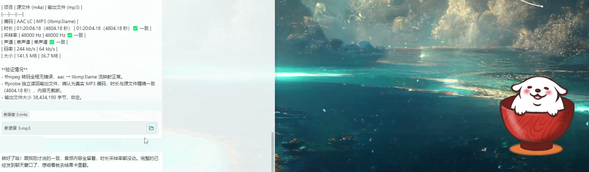
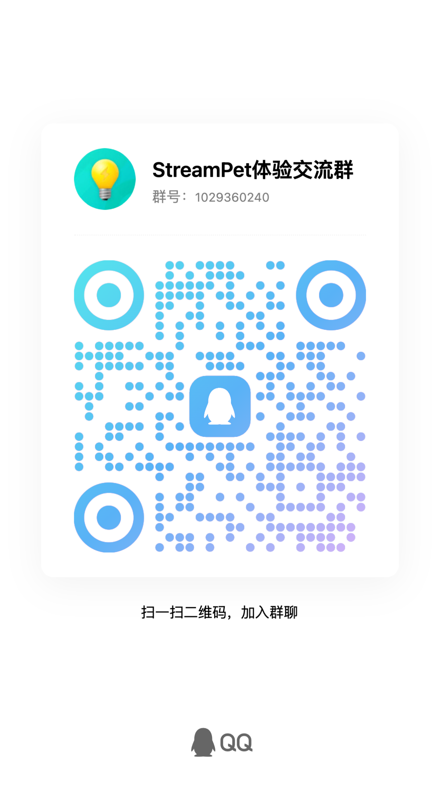

<div align="center">
  
  <h1>NearMate</h1>
  <p><strong>工作在手边，搭子在身边。</strong></p>
  <p>常驻 Windows 桌面的 AI 工作搭子，让你喜欢的角色陪你交流，也帮你推进手头的事。</p>
  <p>
    <a href="https://roverscode.github.io/NearMate/">官方网站</a> ·
    <a href="https://roverscode.github.io/NearMate/guide/">使用手册</a> ·
    <a href="https://github.com/RoversCode/NearMate/releases/latest">下载 Windows 版</a> ·
    <a href="https://roverscode.github.io/NearMate/#community">加入体验交流</a> ·
    <a href="https://github.com/RoversCode/NearMate/issues">问题反馈</a>
  </p>
  <p>Windows x64 · CUDA / Universal 双版本 · Apache-2.0 · 免费开源</p>
</div>

## 让你的桌面，多一个帮手

- **聊你正在看的。** 当前屏幕、选中文字、截图和文件都能成为交流的上下文。问一句「这张图讲了什么」，或把材料交给搭子一起理思路。
- **以你喜欢的方式相处。** 用角色卡设置当前角色的身份和语气，搭配 Live2D 虚拟形象与语音；可以打字，也可以直接说话。
- **让事情继续往前走。** 配置后台工作后，当前角色可以调用工具整理材料、处理文件或完成多步骤操作。需要权限或补充信息时，会请你决定；进展和结果可以在界面查看。

NearMate 承载你选择的角色。上方人物是品牌形象，实际虚拟形象、声音与相处方式由你在应用内配置。

## 它在桌面上是什么样

<div align="center">
  <a href="./website/assets/images/desktop-demo.jpg"></a>
</div>

实机演示：把音频转成 MP3，在聊天窗口查看结果卡与交付文件。右侧为用户配置的虚拟形象。点击图片可以查看大图。

## 2 分 37 秒，认识你的桌面搭子

影片保留真实演示中的角色声音，也带你认识默认角色「火花」：有网感、嘴硬护短，正事认真。再看看角色卡如何定义身份、语气、关系和声音，让你喜欢的角色陪你交流、推进手头的事。

<!-- 更新影片时请重新上传 GitHub 视频附件，并让附件地址单独成段；Releases 下载地址不会生成播放器。 -->

https://github.com/user-attachments/assets/57d22044-e02c-4726-94b5-f83983805162

**播放后请开启声音。** [在官网观看完整宣传片](https://roverscode.github.io/NearMate/#film) · [下载 1080p MP4](https://github.com/RoversCode/NearMate/releases/download/v0.2.0/NearMate-Product-Film-1080p.mp4)

## 下载与安装

前往 [官网下载页](https://roverscode.github.io/NearMate/#download) 或 [GitHub Releases](https://github.com/RoversCode/NearMate/releases/latest)，选择适合这台电脑的版本：

| 版本 | 适合的电脑 |
| --- | --- |
| **CUDA · NVIDIA 版** | 配备兼容 NVIDIA 显卡的 Windows x64 电脑 |
| **Universal · 通用版** | AMD / Intel 等设备；提供 DirectML、Vulkan 与 CPU 运行方式，通过首次向导确认支持情况 |

两种版本提供相同的产品功能，实际运行速度取决于硬件与所选模型。

1. 下载所选版本的安装程序 **`.exe` 和全部 `.bin` 分卷**。
2. 把所有文件放在同一文件夹，保留原文件名，再双击 `.exe` 安装。
3. 打开 NearMate，跟随首次向导完成配置。

**不要混用 CUDA / Universal，也不要混用不同发行的分卷。** Releases 附带 `SHA256SUMS.txt`，可用于核对下载文件是否完整。当前安装程序尚未使用 Windows 代码签名。

## 第一次见面

从安装到第一次聊天，请按 [使用手册](https://roverscode.github.io/NearMate/guide/) 操作。首次向导分为五步：连接 DeepSeek、连接 Qwen、检查电脑、准备语音、试听并开始。两家模型凭据在 Qwen 步骤统一验证并保存。

1. **连接模型 API。** 准备支持的模型服务 API Key，并按向导配置。软件免费使用，模型服务需自行准备。
2. **准备语音与角色。** 按向导检查设备、下载所需语音模型、完成试听，再选择角色卡与虚拟形象。
3. **开始一件小事。** 试着说「帮我解释一下这张图」，或提交一份材料，请搭子整理思路。

需要后台工作时，在控制台的「后台工作」设置中另行配置相应服务、模型与凭据，再选择合适的权限。

### 免费与服务费用

NearMate 自有代码采用 Apache-2.0，软件及内置语音免费使用。模型 API 需要自行准备，费用由对应厂商单独收取；后台工作所接入的服务也可能产生费用。第三方模型、运行库和素材适用各自许可。

### 数据与记忆

桌面界面和部分语音能力在本机运行；模型推理和后台工作可能访问外部服务。对话及选用的屏幕、材料内容会按功能需要发送给已配置的服务，请结合厂商的数据政策选择使用内容。

近期对话和任务上下文在后台进程运行期间保留，退出后台进程后不继续保留。角色卡与设置单独保存。

## 从源码开发

支持 Windows x64，使用 Python 3.12、uv、Node.js 和 pnpm 9。所有命令在仓库根目录执行：

```powershell
pnpm install --frozen-lockfile
pnpm python:venv
pnpm python:install
pnpm dev
```

非 NVIDIA 设备使用 `pnpm python:install:universal` 安装 Python 依赖。首次启动按控制台提示连接模型服务、准备角色语音。依赖来自公开固定发行物，无需申请产品激活码。

文本分词器 `backend/ckpt/tokenizer.json` 随源码提供，安装 Python 依赖后可直接运行 `pnpm backend:test`。分词器的来源与许可见 [第三方声明](THIRD_PARTY_NOTICES.md)。正式测试位于各产品包中，个人试验脚本和本机数据不进入 Git。

源码启动会检查实时输入模型，缺失或损坏时自动从 [ModelScope NearMate](https://www.modelscope.cn/models/ChengHee/NearMate) 的固定版本下载；完整资源约 2.3 GB。控制台会显示准备进度，失败后可重试，尚未配置 LLM 时也能准备资源。已有模型通过大小和 SHA256 校验后直接复用，无需联网检查更新。模型来源、版本与摘要见 [实时资源清单](installer/realtime-assets.json)；原生 DLL 从已安装的固定 StreamVox wheel 准备。角色语音模型继续通过控制台的首次配置流程管理。

安装包构建见 [安装包构建](installer/README.md)。官网源码位于 `website/`，在该目录运行 `npm test`、`npm run check` 和 `npm run build`。

## 一起体验 NearMate

分享角色搭配、交流使用方法，或反馈遇到的问题。

**QQ 体验交流群：1029360240**。用手机 QQ 扫描下方二维码，也可以搜索群号加入。

<div align="center">
  <a href="./website/assets/images/community-qq.jpg"></a>
</div>

二维码与群内名称仍显示历史名称「StreamPet 体验交流群」，即本产品的体验群。

## 反馈问题

请通过 [GitHub Issues](https://github.com/RoversCode/NearMate/issues) 提交问题，说明 NearMate 版本、CUDA / Universal、Windows 版本、硬件概况、复现步骤和错误提示；也欢迎在体验群里交流。

公开提交截图或日志前，请移除 API Key、个人文件路径及私密聊天内容。

## 开源许可

NearMate 自有代码采用 [Apache-2.0](LICENSE)。第三方依赖、Live2D 运行库与模型、语音模型和参考素材分别适用原有许可，详见 [第三方声明](THIRD_PARTY_NOTICES.md)。

## 支持项目

如果 NearMate 对你有用，欢迎给项目点一个 **Star ⭐**，也欢迎分享给需要桌面 AI 搭子的朋友。

想请作者喝杯咖啡，可以使用微信扫描下方二维码。**Star 和赞赏完全自愿，不影响任何功能。**

<div align="center">
  
</div>
